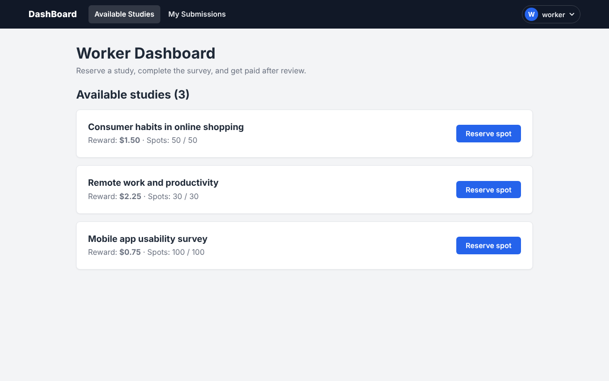
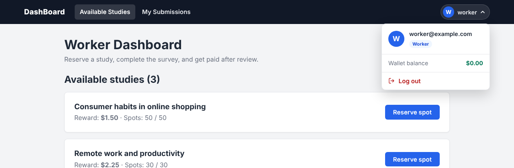
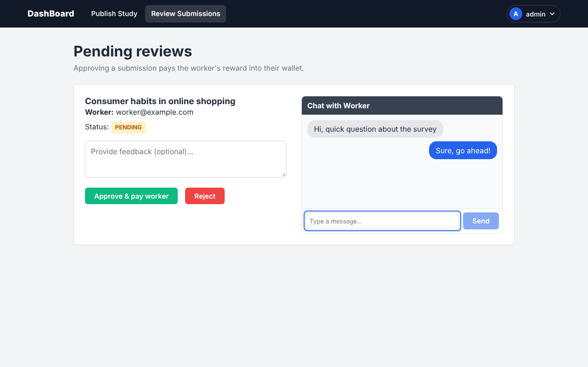
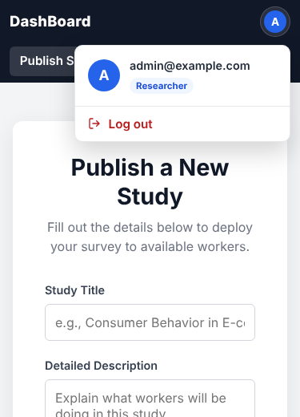

# DashBoard — Research Study Marketplace

A full-stack web app where **researchers publish paid surveys**, **workers complete them for rewards**, and a **super admin moderates the platform**. Includes real-time chat between researchers and workers, a wallet that is paid out on approval, and role-based access control.



## Features

- **Three roles** — Worker, Researcher (Admin) and Super Admin, each with their own dashboard and protected routes.
- **Authentication** — email + password and optional Google sign-in; JWT sessions; passwords hashed with bcrypt.
- **Study lifecycle** — publish → reserve a spot → complete with a secret code → admin review → worker is paid.
- **Wallet** — approving a submission credits the reward to the worker; shown in the account dropdown.
- **Real-time chat** — Socket.io chat between a researcher and the workers who submitted to their studies, with saved history.
- **Moderation** — the Super Admin can suspend and restore accounts; suspended users are signed out immediately.
- **Account dropdown** — accessible user menu (keyboard navigation, closes on outside click / Esc) with the logout action.
- **Responsive UI** — works from phone to desktop.

| Account menu | Review & chat | Mobile |
| --- | --- | --- |
|  |  |  |

## Tech stack

**Frontend:** React 19, Vite, React Router, Axios, Socket.io client, `@react-oauth/google`  
**Backend:** Node.js, Express 5, MongoDB + Mongoose, Socket.io, JSON Web Tokens, bcryptjs

## Getting started

### Prerequisites

- Node.js 20+
- A MongoDB database (local, or a free [MongoDB Atlas](https://www.mongodb.com/atlas) cluster)

### 1. Backend

```bash
cd backend
npm install
cp .env.example .env      # then edit .env (see the table below)
npm run seed              # optional: demo accounts + sample studies
npm run dev               
```

### 2. Frontend

```bash
cd frontend
npm install
cp .env.example .env
npm run dev               
```

### Demo accounts (after `npm run seed`)

Password for all: `Password123!`

| Role | Email |
| --- | --- |
| Super Admin | `superadmin@example.com` |
| Researcher | `admin@example.com` |
| Worker | `worker@example.com` |

The sample studies use the completion codes `DEMO1`, `DEMO2` and `DEMO3`. The seed script refuses to run when `NODE_ENV=production`.

### Environment variables

**`backend/.env`**

| Variable | Required | Description |
| --- | --- | --- |
| `MONGO_DB_URI` | yes | MongoDB connection string |
| `JWT_SECRET` | yes | Long random string used to sign tokens |
| `PORT` | no | API port (default `5000`) |
| `CLIENT_URL` | no | Frontend origin for CORS/Socket.io (default `http://localhost:5173`) |
| `GOOGLE_CLIENT_ID` | no | Enables Google sign-in |
| `EMAIL_USER`, `EMAIL_PASS` | no | Only for the optional email one-time-code endpoints |

**`frontend/.env`**

| Variable | Required | Description |
| --- | --- | --- |
| `VITE_API_URL` | no | Backend URL (default `http://localhost:5000`) |
| `VITE_GOOGLE_CLIENT_ID` | no | Shows the Google sign-in button when set |

## How it works

1. A **researcher** publishes a study with a reward, a number of spots, a survey link and a secret completion code.
2. A **worker** reserves a spot (spots are decremented atomically, so a study can't be over-booked) and gets the survey link.
3. After finishing the survey the worker submits the completion code; the submission becomes *pending*.
4. The researcher **approves or rejects** it. Approval pays the reward into the worker's wallet — exactly once.
5. Both sides can chat in real time from the submission.

## API overview

| Method | Endpoint | Access |
| --- | --- | --- |
| POST | `/api/auth/register`, `/api/auth/login`, `/api/auth/google` | Public |
| GET | `/api/auth/me` | Signed in |
| GET | `/api/auth/users` | Super Admin |
| PUT | `/api/auth/users/:id/block` | Super Admin |
| GET | `/api/studies`, `/api/studies/mine` | Worker |
| POST | `/api/studies/:id/reserve`, `/complete`, `/cancel` | Worker |
| POST | `/api/studies/create` | Researcher |
| GET | `/api/studies/pending` | Researcher |
| PATCH | `/api/studies/:id/review` | Researcher (own studies only) |
| GET | `/api/messages/:userId` | Participants of a shared study |

## Security notes

- The user's identity always comes from the verified JWT, never from the request body.
- Roles are enforced on the server with `authorize(...)`, not just hidden in the UI.
- Workers never receive the completion code, and only see the survey link after reserving.
- Researchers can only review submissions on their own studies; a submission can be reviewed once.
- Socket.io connections are authenticated with the same JWT, and chat is limited to a researcher and the workers on their studies.

## Project structure

```
├── backend
│   ├── controllers/   # auth, studies, messages
│   ├── middleware/    # JWT protect + role authorize
│   ├── models/        # User, Study, Submission, Message
│   ├── routes/
│   ├── scripts/seed.js
│   ├── utils/         # chat access rules
│   ├── socket.js      # authenticated Socket.io server
│   └── server.js
└── frontend
    └── src
        ├── components/  # Navbar, UserMenu (dropdown), ChatBox, ProtectedRoute
        ├── context/     # AuthProvider
        ├── lib/         # axios client, socket client, role helpers
        └── pages/
```
